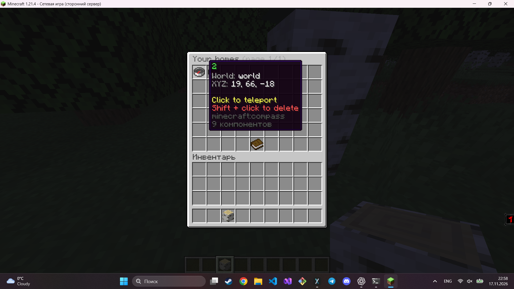
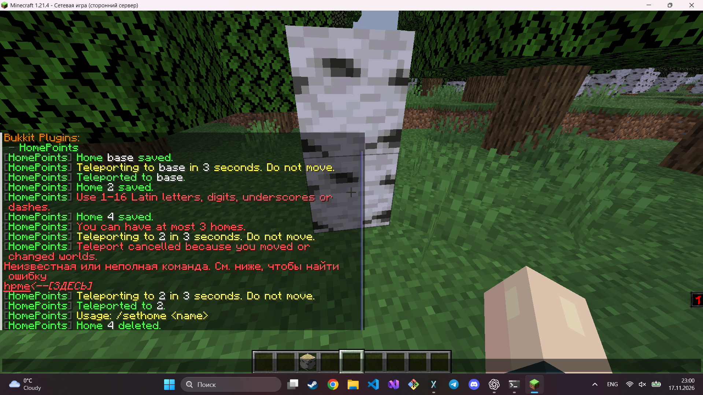

# HomePoints — personal homes for Paper

A small, dependency-free Minecraft plugin written in Java for **Paper 1.21.x**.
This is a test assignment implementation by **AFLAiderLirk**.

## Requirements

- Paper **1.21.4** (the API version used to compile) or a compatible Paper 1.21.x release.
- **Java 21 or newer** on the server and for building. Although the assignment says “Java 17+”, Paper 1.21.x itself requires Java 21.
- Maven 3.9+ for building. The plugin does **not** require Maven on the server.

## Build

```bash
mvn clean package
```

The build produces `target/homepoints-1.0.1.jar`. Put this JAR in the Paper
server's `plugins/` directory and restart the server. The plugin creates
`plugins/HomePoints/config.yml` and `plugins/HomePoints/homes.yml`.

A prebuilt test JAR is also included at `dist/homepoints-1.0.1.jar`.
To update from 1.0.0, stop the server, replace the old plugin JAR, and restart.
Existing saved homes and local configuration are preserved; new config defaults
are read from the updated plugin JAR.

## Commands

| Command | What it does |
| --- | --- |
| `/sethome <name>` | Sets or updates a named home at your current location. |
| `/home <name>` | Teleports to your named home after the configured delay. |
| `/home` | Opens a list of your homes. Click to teleport. |
| `/delhome <name>` | Deletes a named home. |

Home names use 1–16 Latin letters, digits, `_` or `-` and are case-insensitive.
The menu shows up to 45 homes per page and includes navigation. Shift-click a
home to open a confirmation screen before deleting it. Only a player's own
homes are shown.

## Configuration

`plugins/HomePoints/config.yml` contains:

- `homes.max-per-player`: maximum number of homes (default: 3).
- `teleport.delay-seconds`: warmup time (default: 3 seconds).
- `teleport.cooldown-seconds`: wait after a successful teleport (default: 30 seconds).
- `teleport.cancel-on-move`: cancel when a player changes XYZ during warmup
  (default: true; rotating the camera alone does not count as moving).
- `teleport.cancel-on-damage`: cancel a pending teleport if the player takes
  damage during the warmup (default: true; new in v1.0.1).
- `menu.*`: menu titles, icons, and descriptions.
- `messages.*`: all player messages. Minecraft `&` color codes are supported;
  `{home}`, `{max}`, `{seconds}`, `{page}`, `{pages}`, and other relevant
  placeholders are substituted as shown in the default config.

Changes require a **server restart**. Home data is stored by player UUID in
`homes.yml`, with world UUID/name, precise XYZ, yaw and pitch. Writes use a
temporary file and an atomic rename where supported, avoiding partially written
home files.

Permissions (all default to `true`):

| Permission | Allows |
| --- | --- |
| `homepoints.home` | `/home` and GUI teleportation |
| `homepoints.sethome` | `/sethome` |
| `homepoints.delhome` | `/delhome` and GUI deletion |

## Screenshots (Paper 1.21.4)

### Commands and safeguards



In-game checks show HomePoints loading and responding to `/sethome`, `/home`,
and `/delhome`, including name validation, the home limit, teleport warmup and
cancellation on movement. These screenshots were captured using v1.0.0.

### Homes menu



The `/home` inventory GUI displays a saved location with its world, XYZ
coordinates, left-click teleport action, and Shift-click delete action.

## How to test

1. Start a local **Paper 1.21.4** server with the plugin. Run `/sethome base`.
2. Walk to another location and run `/home base`; wait for the delay. Check
   that you return to the original XYZ and that cooldown blocks an immediate
   repeat teleport.
3. Start `/home base` again after cooldown, **move before the timer ends**;
   check that the teleport cancels. Turn your camera without moving; the
   teleport should *not* cancel. Also try taking damage while a teleport is
   pending: in v1.0.1, the teleport should cancel and display a separate
   message. Set `teleport.cancel-on-damage: false` to disable that behavior.
4. Run `/home`; check that the home appears, and click it to teleport.
5. Shift-click the home and confirm the deletion. Run `/home base` and check
   that the home no longer exists.
6. Create several homes and exceed the configured limit; the extra home should
   be rejected. Updating an existing home should still work at the limit.
7. Restart the server with stored homes; verify that they are still there.
8. Test `/home unknown`, `/delhome unknown`, `/sethome invalid.name`, exiting
   during teleport delay, and removing/unloading the world of a saved home.
9. Optional: set `homes.max-per-player` to 50 and check pagination.

## Design

Five focused components keep responsibilities separate:

- `HomePointsPlugin`: bootstrap and listener registration.
- `HomeStore`: YAML persistence and home lookup.
- `HomeCommands`: command validation and tab completion.
- `HomeMenus`: inventory holders, navigation, confirmation, GUI click handling.
- `Teleports`: warmup, movement cancellation, cooldown, safe teleportation.
- `Messages`: configurable colored messages and placeholders.

Minecraft API calls (including `Player#teleport`) run on the **main server
thread**; delayed actions use the Bukkit scheduler rather than an async task.

No external database, Kotlin, or runtime dependency is required.
